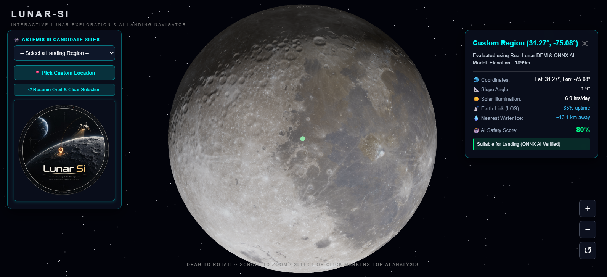
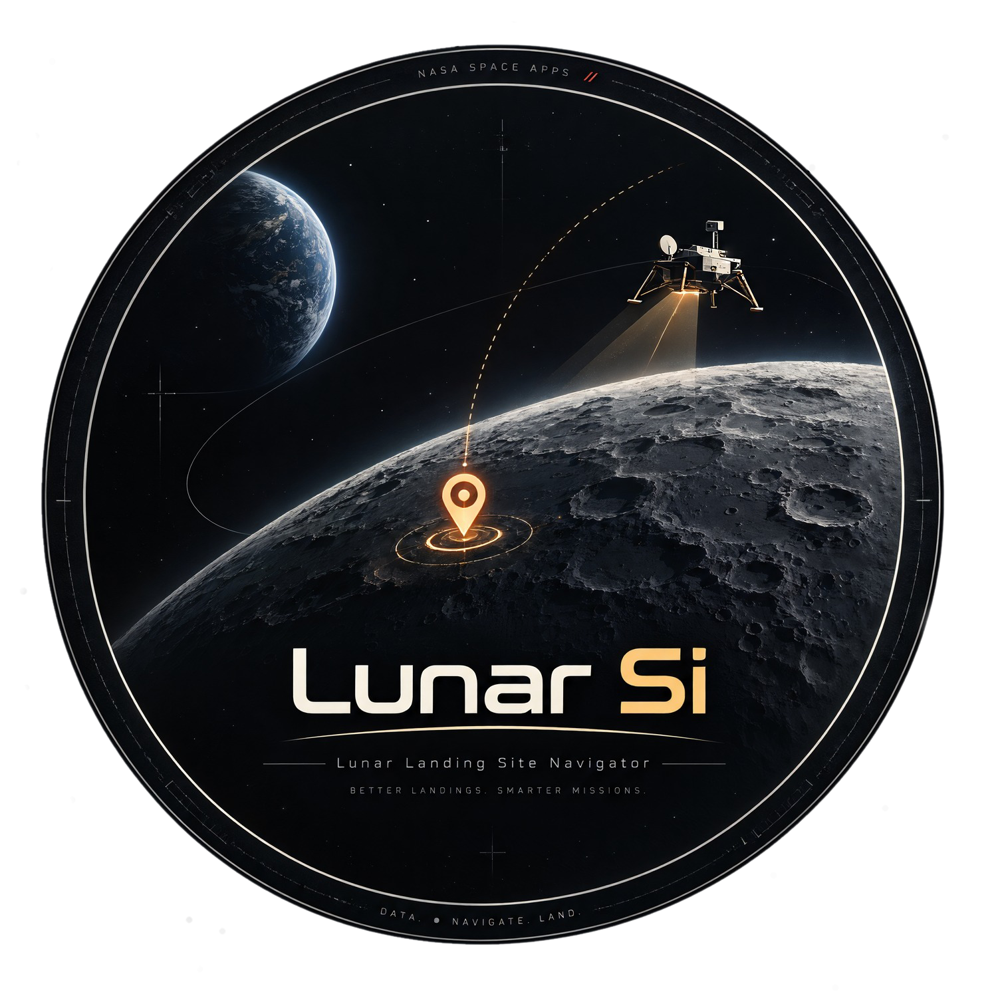

# Lunar-Si: Interactive Lunar Exploration & AI Landing Navigator

> **Empowering Artemis III Mission Planning with Real Lunar Topography and Custom-Trained AI Safety Scoring.**


<div align="center">
  
</div>
 
## HIGH-LEVEL PROJECT SUMMARY

**Lunar-Si** is an advanced, high-performance full-stack web platform designed to bridge the gap between complex raw lunar geodetic data and intuitive mission planning. Our solution empowers aerospace engineers, researchers, and space enthusiasts to explore potential lunar landing sites in an immersive 3D environment, analyze surface topography, and calculate environmental mission telemetry in real-time. 

By seamlessly integrating official NASA Lunar Reconnaissance Orbiter (LRO) datasets with our **custom-trained machine learning model** specifically engineered for lunar safety evaluation (**ONNX Runtime**), an asynchronous **FastAPI** backend, and a cutting-edge 3D interactive frontend built with **React, Vite, and Three.js**, Lunar-Si delivers instant, physics-based safety assessments and illumination modeling for any location on the Moon, with specialized geodetic precision tailored for the extreme terrain of the lunar South Pole.

## DETAILED PROJECT DESCRIPTION

The platform is architected into an immersive 3D frontend, a high-speed asynchronous backend, a custom-built AI model, and precise geodetic data processors:

* **Interactive 3D Frontend:** Developed using **React, Vite, Three.js, and React Three Fiber** (`@react-three`), delivering a smooth, hardware-accelerated 3D digital globe of the Moon. It features real-time camera controls (`camera-controls`), GPU capability detection (`detect-gpu`), spatial text rendering (`troika-three-text`), and reactive state management (`zustand`) to inspect landing coordinates and visualize safety metrics dynamically.

* **Backend Architecture:** Developed using **FastAPI** (Python framework) for high-concurrency and blazing-fast RESTful performance. It includes robust Pydantic data validation and automatic OpenAPI documentation (`/api/docs`).

* **Custom-Trained AI Safety Model:** We engineered and trained a bespoke machine learning model specifically tailored for lunar landing safety evaluation. Exported to **ONNX format (`lunar_safety_model.onnx`)** and executed via **ONNX Runtime** directly on the server, the model evaluates multi-variable terrain parameters (slope, elevation, solar illumination, Earth Line-of-Sight, and water ice proximity) to generate an instant, physics-grounded **AI Safety Score** ($\text{1\%} - \text{99\%}$).

* **Binary Topography Processing:** Directly reads and parses raw 16-bit binary elevation grids (`ldem_2048x1024_uint16.bin`) from NASA's LRO/LOLA missions. It extracts precise positive and negative elevations and computes micro-slopes on the fly.

* **Geodetic Polar Correction:** Implements advanced mathematical corrections using the cosine of latitude ($\cos(\text{lat})$) to neutralize longitude compression near the lunar poles, ensuring realistic slope calculations ($3^\circ - 8^\circ$ on stable highland rims) instead of artificial distortions.

* **Dynamic Environmental Modeling:** Calculates daily solar illumination hours by factoring in latitude, crater depth (Permanently Shadowed Regions - PSRs), and terrain shadow penalties.

## NASA DATA SOURCES & SCIENTIFIC ALIGNMENT

The scientific framework of Lunar-Si is strictly aligned with official NASA resources and mission data:

* **LRO/LOLA DEM Binary Data:** High-resolution lunar laser altimeter topography grids (`ldem_2048x1024_uint16.bin`) for precise elevation and slope profiling.

* **Artemis III Candidate Landing Sites:** Pre-loaded database of all 13 official NASA candidate landing sites in the lunar South Pole (e.g., *Faustini Rim A*, *Shackleton Ridge*, *Nobile Region*).

* **NASA Quickmap & Moon Trek Standards:** Topographic visualization logic and spatial understanding inspired by NASA's leading exploration tools.

* **Horizons Ephemeris Principles:** Astronomical positioning logic for solar angles, lighting, and line-of-sight communication assessments.

* **International Partnerships (CSA):** Structured to support collaborative lunar exploration frameworks.

## KEY FEATURES & TECHNICAL HIGHLIGHTS

* **Immersive 3D Lunar Globe:** Navigate and inspect the lunar surface in real-time 3D powered by Three.js and React Three Fiber.

* **Custom-Trained AI Safety Scoring:** Leverages a bespoke machine learning model trained explicitly to translate complex geological hazards into clear, actionable safety ratings.

* **Interactive Coordinate Evaluation:** Click or select points on the 3D lunar model to evaluate custom coordinates instantly.

* **Comprehensive Telemetry:** Monitors Earth Line-of-Sight (LOS) communication uptime, water ice proximity, and solar exposure.

* **Optimized Performance:** Features dynamic absolute path resolution (`BASE_DIR`) on the backend and Vite bundling on the frontend for seamless deployment across local servers and cloud environments.

## API ENDPOINTS OVERVIEW

| Endpoint | Method | Description | 
| ----- | ----- | ----- | 
| `/api/health` | `GET` | System health check (verifies DEM binary and custom ONNX AI model loading status). | 
| `/api/sites` | `GET` | Returns evaluated telemetry and safety scores for all 13 official Artemis III sites using our custom AI. | 
| `/api/evaluate-coordinate` | `GET` | Evaluates any custom user-clicked coordinate (`lat`, `lon`) using real DEM and our custom-trained ONNX AI model. | 

## TECH STACK

* **Frontend:** React, Vite, Three.js, React Three Fiber, Three-Stdlib, Camera-Controls, Zustand, Zod, Tailwind CSS / Modern CSS.

* **Backend Framework:** Python, FastAPI, Pydantic, Uvicorn

* **Artificial Intelligence:** Custom-Trained Machine Learning Model, ONNX Runtime, NumPy

* **Geospatial & Mathematical Processing:** Struct, Math, Custom Geodetic Polar Projections

* **Deployment & Version Control:** Git, GitHub, Vercel Ready

## PROJECT SETUP & INSTALLATION

### 1. Clone the Repository

```
git clone https://github.com/sarah-salem2200/Lunar-Si
cd lunar-si

```

### 2. Set Up and Run the Backend

Navigate to the backend directory and install dependencies:

```
cd backend
pip install fastapi uvicorn numpy onnxruntime pydantic

```

Ensure the following files are placed in the app directory:

* `lunar_safety_model.onnx` (Custom-trained ONNX AI safety model)

* `ldem_2048x1024_uint16.bin` (Lunar DEM binary file)

Run the FastAPI server:

```
uvicorn app.main:app --reload

```

### 3. Set Up and Run the Frontend

Navigate to the frontend directory, install dependencies, and start the development server:

```
cd ../frontend
npm install
npm run dev

```

### 4. Access Interactive API Documentation

Open your browser and navigate to:
`http://127.0.0.1:8000/api/docs`


---


## NASA DATA & RESOURCES

The scientific framework and data processing of Lunar-Sir are built upon official U.S. Government and international partner resources:

- **LRO/LOLA DEM Binary Data:** High-resolution lunar laser altimeter topography grids (`ldem_2048x1024_uint16.bin`) for precise elevation and slope profiling derived from NASA's Lunar Reconnaissance Orbiter.
- **Quickmap (Arizona State University):** Interactive mapping tool providing access to high-resolution lunar imagery and topographic datasets from NASA's LRO, utilized for surface visualization and understanding south pole topography.
- **Moon Trek (NASA):** Interactive 3D visualization tool for lunar exploration, serving as the conceptual benchmark for spatial terrain understanding and potential landing site evaluation.
- **Horizons System (NASA JPL):** Ephemeris computation tool calculating precise positions and velocities of celestial bodies, forming the mathematical foundation for solar illumination and Earth Line-of-Sight (LOS) assessments.
- **Artemis III Candidate Landing Sites:** Pre-loaded database of all 13 official NASA candidate landing sites in the lunar South Pole region (e.g., Faustini Rim A, Shackleton Ridge, Nobile Region).

---

## SPACE AGENCY PARTNER RESOURCES

- **CSA (Canadian Space Agency) - Moon Exploration:** Integrated into our broader mission context to acknowledge Canada's contributions to lunar exploration technologies, scientific research, and participation in the Artemis program.


---

## CONTRIBUTORS

- [Sarah Salem](https://github.com/sarah-salem2200)
- [Engy Salem](https://github.com/engy-salem)


---

<div align="center">
  
</div>